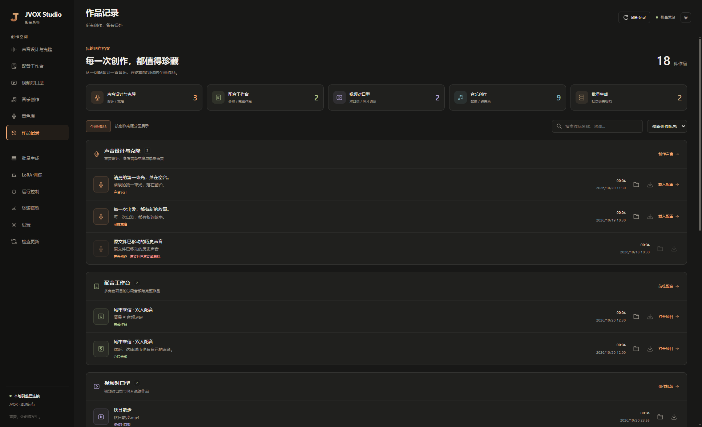
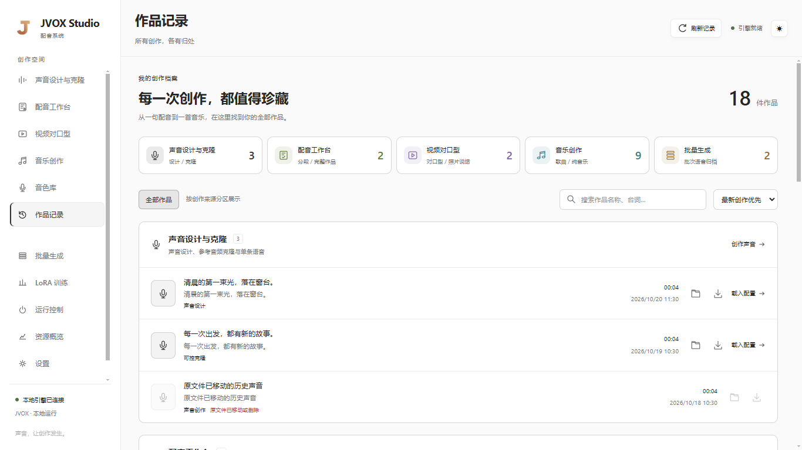

# 全功能作品记录

作品记录按创作来源统一展示，不再依附当前配音项目，也不显示与记录无关的文案导入和合成按钮。



| 分区 | 收录内容 | 可用操作 |
| --- | --- | --- |
| 声音设计与克隆 | 声音设计、可控克隆、极致克隆生成的单条声音 | 试听、定位、另存、载入原文与配置 |
| 配音工作台 | 各项目的分段音频和完整导出作品 | 试听、定位、另存、打开原项目 |
| 视频对口型 | 视频对口型、照片说话生成的 MP4 | 视频预览、定位、另存 |
| 音乐创作 | 所有音乐模型生成的歌曲与纯音乐 | 试听、定位、另存；显示来源模型 |
| 批量生成 | 各批次中的每条语音 | 逐条试听、定位、另存；整批 ZIP 导出 |

顶部分类卡片显示各区数量，点击筛选，再次点击或选择「全部作品」恢复总览。搜索作品名称、台词和类型标签，可按时间或名称排序。各区默认显示六件，点击「显示更多」逐步展开全部记录；该展示数量不限制已收录的作品总数。

音频共用底部播放器，切换作品停止原音频；视频在独立预览框播放，可用关闭按钮或 Escape 退出。首次没有作品时，每个分区提供对应创作入口。原文件丢失时保留历史记录与提示，禁用试听、定位和单文件导出；仍可打开项目或载入已有配置。刷新失败保留已读取记录，恢复服务后重试。



## 数据兼容

新增 `/api/workspace/works` 聚合接口；原 `/api/workspace/history` 继续只提供音频历史，保持视频页选择配音的兼容性。已有声音与配音历史、音乐与视频 `result.json`、当前输出目录的批量 `manifest.json` 自动收录；不迁移或复制原作品媒体。

音乐和视频的作品总览读取全部结果，功能页自身仍保留最近 50/30 条的原有接口行为。旧结果未记录生成时间时使用结果清单的文件时间。批量旧清单没有时长时显示「—」，播放后播放器可读取实际时长。

新批量完成时将清单路径存入 `workspace.json` 的 `batches`，重启后继续可见。在设置中更改输出位置前，也会登记原目录下的旧批量清单，避免切换位置后丢失记录。已移到未知位置、未留下清单的文件无法自动还原；将旧输出位置重新设为当前输出目录后可发现其中的有效批量清单。

音色库保存的参考素材与 LoRA 训练模型继续在各自的素材管理页管理；作品记录收录实际生成的音视频内容。

## 验证

```powershell
pwsh -NoProfile -File scripts/validate_local.ps1
python scripts/test_music_suite.py tests/test_studio_works.py tests/test_studio_workspace.py tests/test_studio_music.py tests/test_studio_lipsync.py -q -p no:cacheprovider
pwsh -NoProfile -File scripts/validate_local.ps1 -Script scripts/smoke_works_library.cjs
```

前端在 `frontend/voxcpm_studio_electron` 执行 `npm run typecheck` 与 `npm run build`。Electron 验收运行完整开发版和真实本地 API，使用隔离的有效 WAV/MP4 夹具，复用已安装 Python 与模型路径，不调用 AI/GPU、不下载资源、不修改正式安装。只替换主进程原生文件对话框的返回值与文件定位外壳，用实际按钮、IPC、API 验证单文件和 ZIP 导出字节一致。报告与八组深浅主题布局截图保存在 `builds/works-library-validation/<运行编号>/`。
