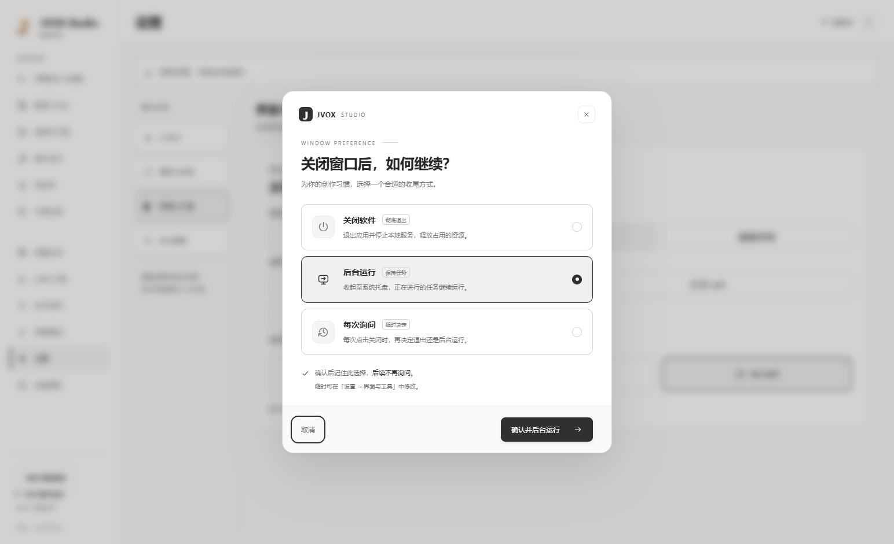
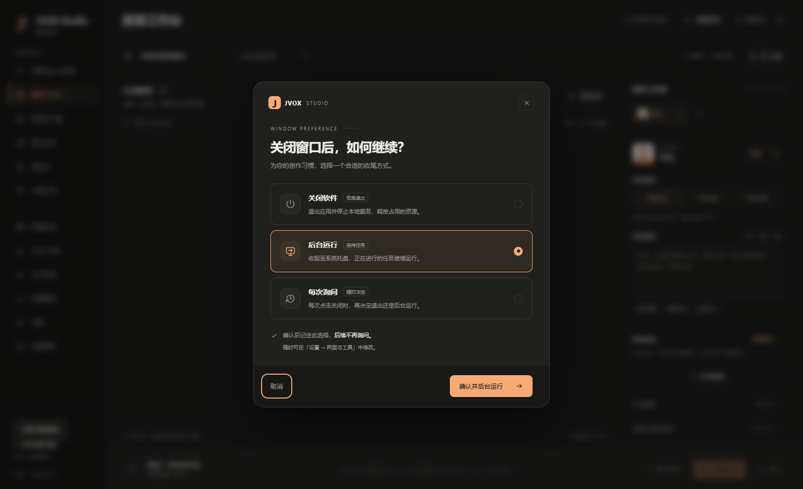

# 关闭窗口与后台运行

2.0.4 起，首次点击窗口右上角 × 会显示与当前主题一致的退出确认弹窗。

| 退出偏好 | 确认后的行为 | 后续关闭 |
| --- | --- | --- |
| 关闭软件 | 退出应用，停止本地服务，释放资源 | 直接退出，不再询问 |
| 后台运行 | 收起至系统托盘，进行中的任务继续运行 | 直接收起，不再询问 |
| 每次询问 | 本次选择关闭软件或后台运行 | 下次仍显示确认弹窗 |

取消、右上角小叉或按 Escape 均返回软件，不保存本次选择。确认后的偏好跨重启保存，可在「设置 → 界面与工具 → 关闭窗口时」修改，即时保存、下次关闭生效。

后台运行时，双击系统托盘 JVOX 图标或再次运行软件即可回到原工作台。右键托盘图标选择「退出软件」可直接彻底退出。后台运行会继续占用正在使用的系统资源。

软件更新重启和系统关机不会被退出偏好阻挡；升级保留偏好与用户数据。直接退出会停止本地服务及未完成的任务，关闭前请保存当前编辑内容。

